# Flat Designer

A web application for designing flats and houses in 3D. Projects consist of one or more floors with rooms,
walls, doors and windows, finishes and furniture. Custom-made furniture is described as data: parametric
furniture definitions whose parts are sized by expressions. The application produces the 3D model, a floor plan,
a first-person walkthrough and a cut list from them, and AI agents can do all of it over MCP.

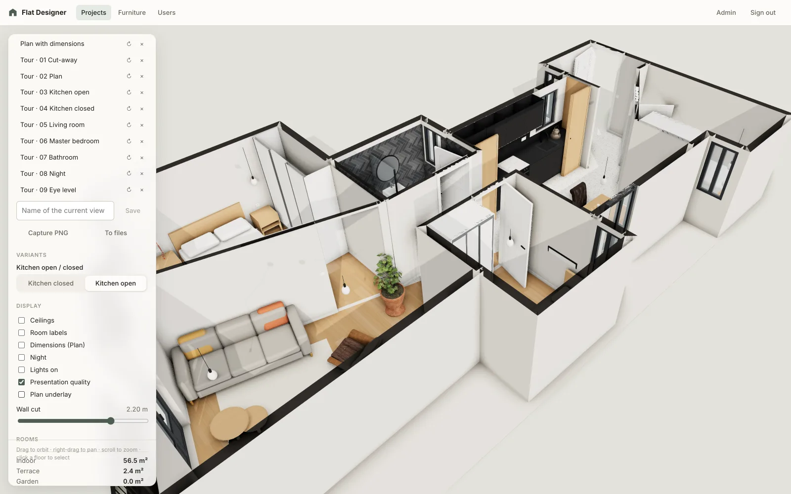

All geometry is generated from parameters. The repository contains no 3D model files: bought products are glTF
models you upload into the app. The screenshots show the demo flat, which an AI agent modelled over MCP (see
[Built over MCP by an AI agent](#built-over-mcp-by-an-ai-agent)).

## Feature tour

### Floor plan with dimensions

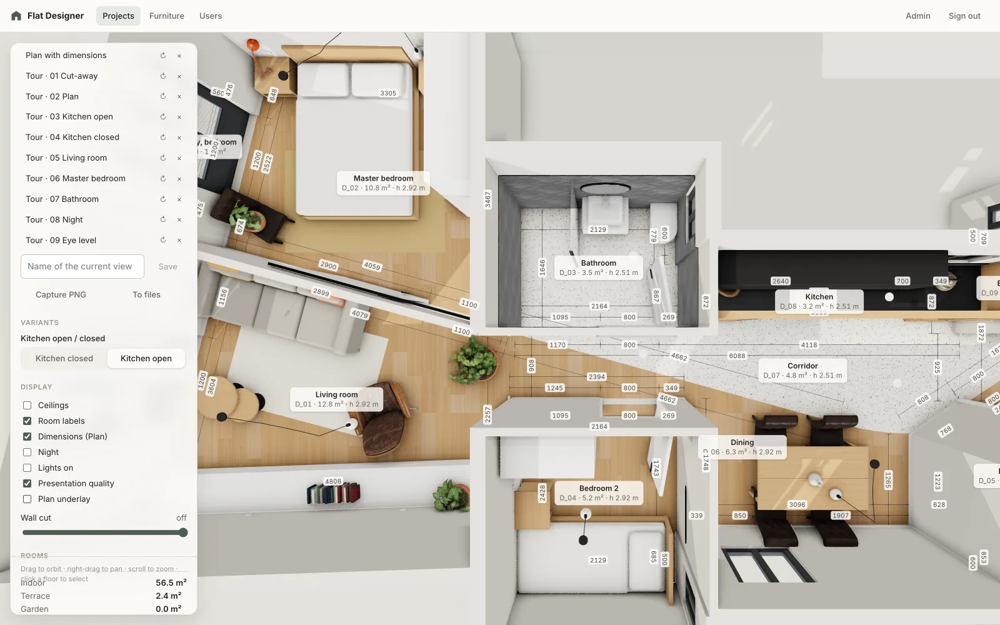

The plan view cuts the walls at 1.3 m (adjustable) and draws every room edge's dimension line, split at doors and
windows. A measure tool snaps to wall ends, corners and faces, and a calibrated image of a plan can lie underneath.

### Room schedule

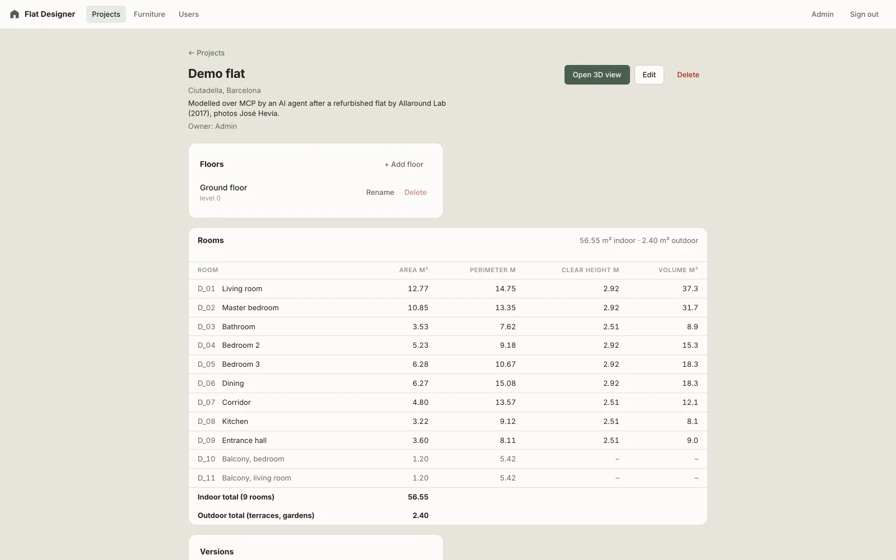

The project page lists each room's net area, perimeter, clear height and volume, with indoor and outdoor totals.
Below it, the electrical schedule lists for the electrician each room's lights, sockets (with their gangs), switches,
data sockets and plumbing points with their elevations. Floors, versions, share links and project files are managed
here too.

### Eye-level views and the walkthrough

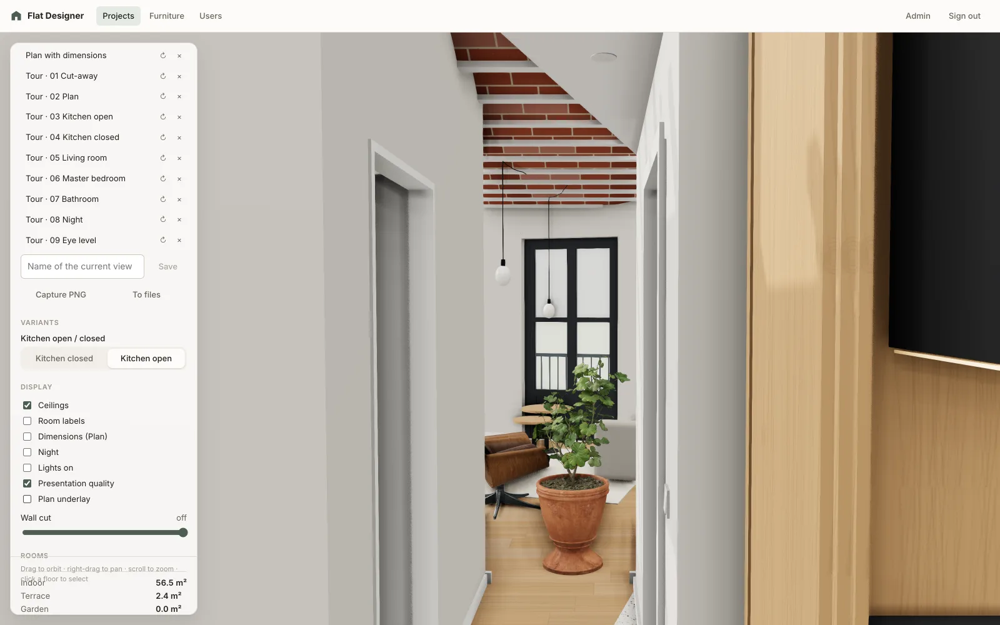

Walk through the flat in first person with collisions and doors you can open, using the keyboard and the mouse or
touch controls. Saved views keep eye-level shots like this one, with their camera and display options.

### Kitchens and built-ins

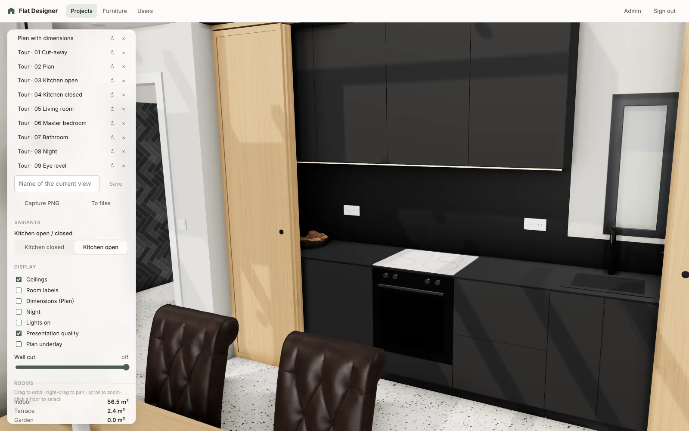

Cabinets, worktops, end panels and appliances come from furniture definitions with parameters for fronts, handles
and materials. The oak sliding panels are a definition the agent wrote for this flat.

### Variants

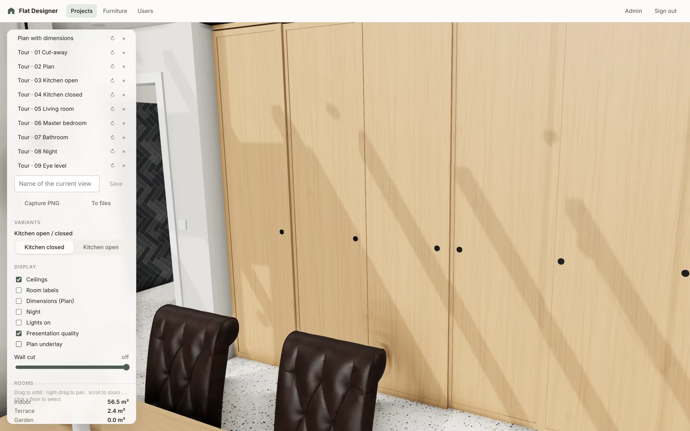

Group items into pieces of furniture and keep alternatives as variants of a set, here "Kitchen open / closed".
Switching variants is one click, and saved views and share links remember the one they show.

### Materials, finishes and ceilings

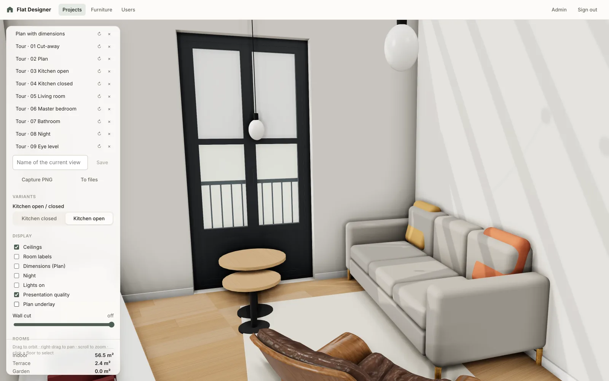

A shared material catalogue with procedural and photo textures: planks, tiles, terrazzo, brick and herringbone on
one tile grid per room. Ceilings can be vaulted between beams, with skirting, French windows, shutters and railings. Columns and
downstand beams are cut by the section like walls, and walls can have niches.

### Furniture, textiles and product models

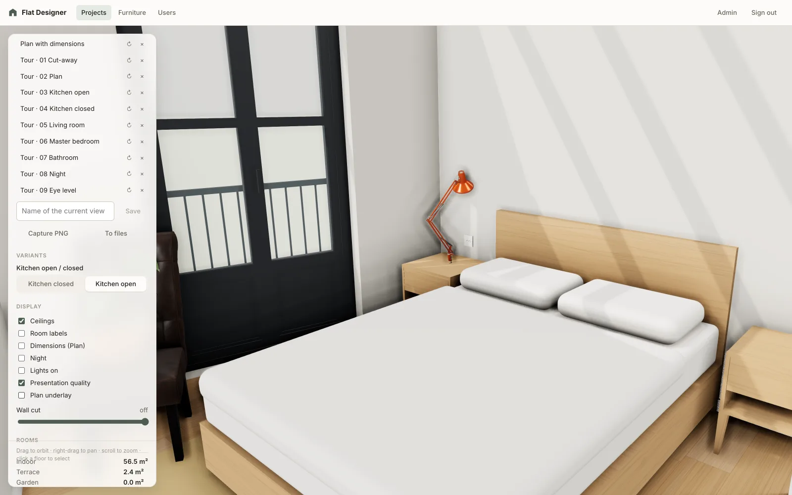

Beds with bedding, sofas, rugs, curtains, books and framed pictures are definitions. Bought products such as the
lamp, chairs and plants are uploaded glTF models that scale to fit their box.

### Bathrooms

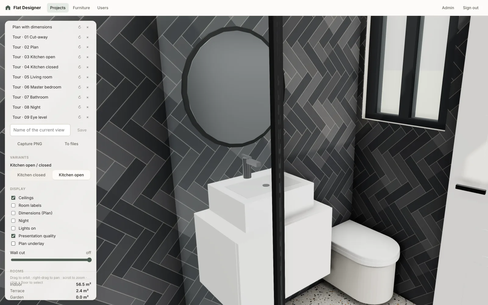

Wall finish bands, tile grids and sanitary ware: a walk-in shower screen, a wall-hung vanity, a round mirror and
a WC. Doors have panelled, flush or glazed leaves, frame styles and handles.

### Lighting at night

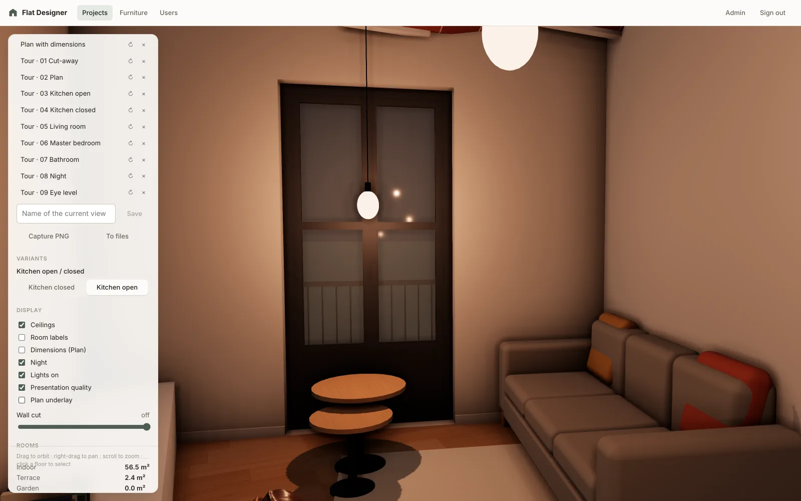

Pendants whose cables follow the vaulted ceiling, downlights and lamp lights have lumens and a colour
temperature. The night view switches off the sun and lights the flat with its own fixtures.

### Editor

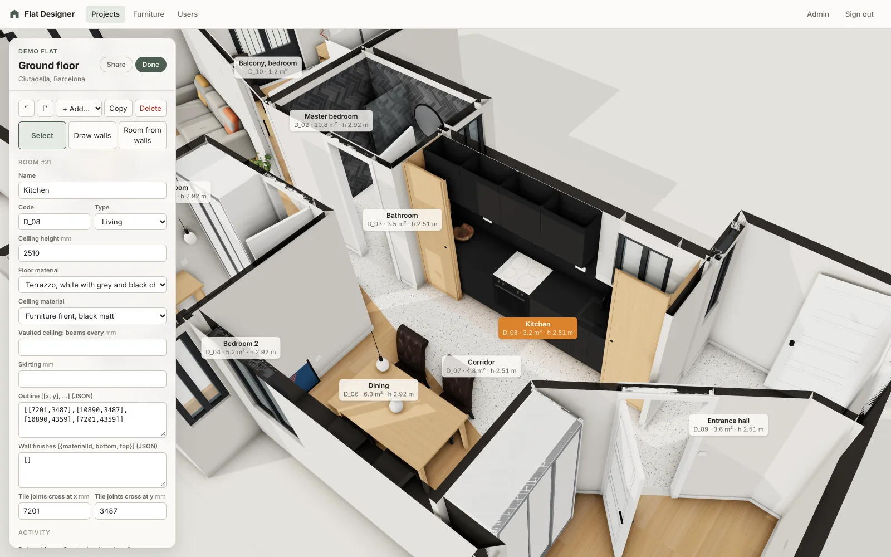

Select rooms, walls, openings and items and edit them in the inspector, drag them in the plan, draw runs of walls
with snapping (straight or curved), bend a wall by its middle, and outline a room by clicking inside it. Every change is logged, and you can undo your own.

### Furniture definitions

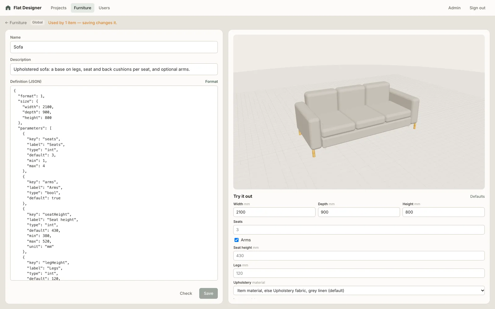

A definition is JSON: parameters, material slots and parts sized by expressions of the item's width, depth and
height. The editor previews it live, and the form on the right is generated from its parameters.

### Cut list

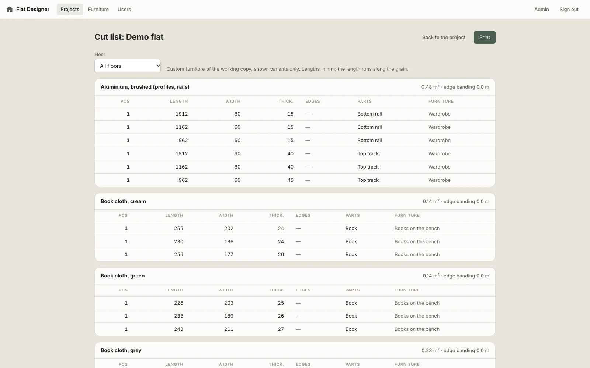

Boards and fronts of the custom furniture, listed by material, thickness and grain direction with edge banding,
plus area and banding totals per material. It prints as a sheet for the workshop.

### Quantities and cost

What to buy for each room: floor area, wall finish bands (tiling), the paint around and above them up to the ceiling
with doors and windows left out, ceilings (vaults and beams included) and running metres of skirting. Tiles and
planks are counted in whole pieces, with a waste allowance. Enter a project's prices per m² or running metre, and
the page totals the cost per room and for the whole project, furniture boards from the cut list included.

### Share links

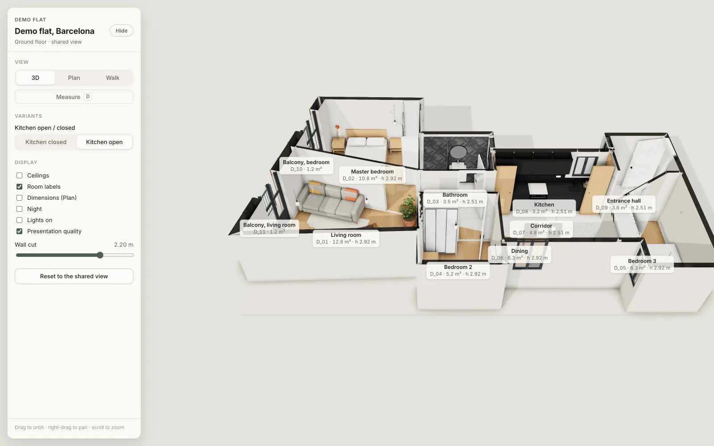

A read-only guest view of a floor, without an account, with the allowed views, a start camera and display options.
Guests can orbit, read the plan, walk through and switch variants, and download the plan, elevations and 3D
model unless the link forbids it. A link can also show the floor's open review comments, and let guests add some.

### Review comments

Comments are pinned to a point in the scene: press <kbd>C</kbd>, click a wall, a worktop or the floor, and write.
Each thread has a numbered pin in the viewer, replies and a Resolve button. The project's owner, share link guests and
connected agents all write comments, so an agent can read what people want changed, reply and resolve the thread once
it has made the change.

### And also

- **Versions**: immutable snapshots of a project that can be restored at any time.
- **Saved views and screenshots**: named cameras with display options and variants. `make screenshots` captures
  them (these images are made that way), and the viewer saves a PNG at presentation quality.
- **Exports**: the floor plan on A4 at a standard scale (walls, door swings, windows, room areas, dimensions and
  furniture footprints) as a PDF with the room schedule, or as an SVG; wall elevations of every room for the tiler
  and the joiner (tile joints on the room's grid, openings, fitted furniture, dimensions); and the floor as a 3D
  model (glTF) for Blender or SketchUp.
- **Presentation quality**: ambient occlusion, antialiasing and soft sun shadows for renders.
- **Live collaboration**: open viewers update in real time (Mercure) when someone else changes the project.
- **Project files**: plans, renders and photos in S3-compatible storage. Plans can be traced as underlays.
- **AI agents (MCP)**: a built-in MCP server lets agents such as Claude read and edit projects, with the same
  validation and history as the UI.
- **Accounts**: sign-up, JWT authentication, `Admin` and `User` roles. Users own their projects; admins see all
  projects and manage users.

## Built over MCP by an AI agent

The demo flat in the screenshots was modelled by Claude Code through the app's MCP tools alone, with no clicks in
the editor. It is modelled after the *Refurbishment of an Apartment in Barcelona* by Allaround Lab (2017), photos
by José Hevia. The original plan and photos are not part of this repository, and the images here are our own
renders.

The input was the published plan, a section and twelve photos uploaded as project files, plus a written
inventory of the flat ([docs/demo-flat.md](docs/demo-flat.md)). The agent worked in phases and saved a version
after each one:

1. Read the plan with `get_project_file` and calibrate it as an underlay from the scale bar (`set_floor_underlay`).
2. Draw the facade, shell and partitions as runs of walls (`add_walls`) and outline the rooms (`detect_room`).
3. Add doors, French windows with shutters, light-well windows, balconies and railings.
4. Set the finishes: oak and terrazzo floors, brick vaults between beams, a dropped ceiling, tiles and skirting.
5. Build the kitchen from definitions, and write a new definition for its oak sliding panels, with an open and a
   closed variant.
6. Furnish every room from the plan, grouping each piece of furniture. Bought products are uploaded models.
7. Add the lights, switches, sockets and decor, then save views at the photos' camera positions and create a
   share link.
8. Compare the views with the photos, fix what was wrong, and log what the app cannot do yet as tasks.

| | |
| --- | --- |
| Time | 22 minutes |
| MCP tool calls | about 190 |
| Logged changes | 212 |
| Walls, openings, rooms | 27, 13, 11 |
| Items | 89 in 8 groups, 1 variant set |

The product models are CC0 models from [Poly Haven](https://polyhaven.com), uploaded into the app and not part of
this repository. Where no model matched (the Cesca and butterfly chairs, the vessel basin, black taps), the
demo uses stand-ins.

## Tech stack

| Layer | Technology |
| --- | --- |
| Frontend | Angular 22 (standalone components, signals, zoneless), three.js, SCSS, Vitest |
| Backend | PHP 8.5 on FrankenPHP (worker mode), `marekskopal/orm`, `marekskopal/router`, `mcp/sdk` |
| Data | MariaDB 11.8, MinIO / S3 for files, Mercure (built into FrankenPHP) for live updates |
| Infrastructure | Docker Compose, nginx reverse proxy (optional TLS) |

## Getting started

Requirements: Docker with Compose, `make` and `openssl`. To develop the frontend or run lint and tests on the
host, you also need PHP 8.5 with Composer, Node.js and pnpm.

```sh
make up      # build and start the stack on http://localhost:4400
make admin   # create the first admin account (prompts for email and password)
```

On the first run, `make up` creates `.env` from `.env.example` and generates the token and Mercure secrets. The
backend applies pending database migrations on start, so a fresh database includes a sample project and the
global material and furniture catalogues.

New users can sign up at `/sign-up` and get the `User` role. Admins manage accounts under **Users**.

To import reference files (plans, renders, photos) into a project:

```sh
make import-files DIR=path/to/files PROJECT=1
```

To upload a directory of `.glb` models (global, or a project's own with `PROJECT`), each with an optional
`<name>.json` sidecar holding `name`, `license`, `author` and `sourceUrl`:

```sh
make import-models DIR=path/to/models [PROJECT=1]
```

The repository ships no third-party models. Keep downloaded ones outside git (e.g. in the ignored
`source_files/`) and upload them into the app.

To refresh the screenshots in `docs/screenshots/` from a project's saved views, the editor and the pages around
the viewer (the stack must be running; with `cwebp` installed they are saved as WebP):

```sh
make screenshots PROJECT=5 EMAIL=you@example.com PASSWORD=… VIEWS="Tour ·" ROOM=Kitchen
```

`VIEWS` keeps only the saved views whose name starts with it, and `ROOM` is the room selected for the editor shot.
The plan underlay is hidden in the screenshots.

To measure the rendering cost of the saved views, run the benchmark before and after a change. Add `?stats` to a
viewer URL for a live readout.

```sh
make benchmark PROJECT=5 EMAIL=you@example.com PASSWORD=… VIEWS="Tour ·"
make benchmark PROJECT=5 EMAIL=you@example.com PASSWORD=… VIEWS="Tour ·" BASELINE=frontend/benchmarks/<earlier>.json
```

### Configuration

All settings are in `.env`. `.env.example` documents each variable. The most important ones:

| Variable | Purpose |
| --- | --- |
| `PROXY_PORT` | HTTP port of the proxy (default `4400`) |
| `PROXY_HOST` | Public hostname. Required for OAuth/MCP behind a domain |
| `AUTHORIZATION_TOKEN_KEY` | JWT signing key (generated). Changing it signs everyone out |
| `MYSQL_*` | Database connection |
| `S3_*` | Object storage. Defaults to the bundled MinIO (console on `MINIO_CONSOLE_PORT`, default `4401`) |
| `FILE_MAX_SIZE_MB` | Largest accepted upload |

**HTTPS**: uncomment `COMPOSE_FILE` in `.env` to include `docker-compose.ssl.yml`, then set `PROXY_SSL_CERT` /
`PROXY_SSL_KEY`, or run `make ssl-cert` to generate a self-signed localhost certificate. The stack then serves
`https://localhost:4443` (`PROXY_PORT_SSL`), and the HTTP port redirects there.

## Development

```sh
make install   # backend and frontend dependencies on the host
make dev       # Angular dev server on http://localhost:4200, API proxied to the running stack
make lint      # phpcs + phpstan (max level), eslint
make test      # phpunit (separate flat_designer_test database), vitest
make reset-db  # drop the database and file volumes and re-seed
```

Schema and seed data changes always go into a new migration in `backend/migrations/`. If you edit a migration
that has already been applied, run `make reset-db`.

CI (GitHub Actions) runs composer and pnpm audits, PHPStan, PHP_CodeSniffer, PHPUnit, ESLint, Vitest and the frontend build.

### Repository layout

| Path | Contents |
| --- | --- |
| `proxy/` | nginx: `/api/*`, `/mcp`, OAuth discovery and Mercure → backend, everything else → frontend |
| `backend/src/` | Controllers, services (`Editor`, `Furniture`, `CutList`, `Project`, `Realtime`, …), entities, MCP tools, OAuth |
| `backend/migrations/` | Schema and seed data; `furniture/*.json` holds the seeded global furniture definitions |
| `backend/tests/` | PHPUnit unit and integration tests; shared fixtures for the expression language |
| `frontend/src/app/` | Angular pages and components (`editor`, `furniture`, `projects`, `viewer-page`, `share`, …) |
| `frontend/src/app/viewer/engine/` | Framework-free three.js engine: building, items, furniture definitions, walkthrough |
| `docs/` | Design notes and plans; `screenshots/` holds the README images |

## Conventions

- Lengths are integer **millimetres** in plan coordinates. The origin is the inner south-west corner of the
  floor, x points east and y points north.
- Item rotation is in degrees counter-clockwise; 0 means the front faces south.
- Walls are centre lines with a thickness, straight or curved (an arc given by its sagitta). Openings are positioned by
  their offset along the wall from its start.
- Openings are doors (single, double, sliding, pocket), passages without a door, windows and niches (recesses into one
  face of the wall). Doors have a frame style
  (lining, architrave, flush, none), a handle (lever, knob, pull, none) and a flush, panelled or glazed leaf. Windows
  are divided by mullions and transoms, can have sill boards, a solid lower panel and louvred or solid exterior
  shutters, and two windows meeting at a wall corner form a corner window.

## AI agents (MCP)

The backend is an MCP server at `/mcp` (Streamable HTTP, OAuth 2.1 with dynamic client registration and PKCE).
Agents can create, rename and delete projects, read projects and floors, add floors, add, change and delete rooms, walls, openings and items, manage groups,
variants, share links, versions and furniture definitions, upload project files and product models, get cut lists, room and electrical schedules and quantities, set prices, read, write and resolve review comments, and undo or redo their own changes.
Agent changes are logged under the client's name and appear live in open viewers.

Connect Claude Code:

```sh
claude mcp add --transport http flat-designer http://localhost:4400/mcp
```

Approve the connection in the browser that opens. In claude.ai, add the URL as a custom connector (the app has
to be on a public HTTPS host with `PROXY_HOST` set). Connected agents are listed on the **Account** page, where
you can also revoke them.

## API overview

Every endpoint except health, authentication, OAuth, public share links and one-time upload URLs requires a Bearer
access token.

| Endpoint | Description |
| --- | --- |
| `/api/authentication/{login,sign-up,refresh-token}` | Sign-in and token refresh |
| `/api/current-user`, `…/password`, `…/mcp-clients` | Account, password change, connected agents |
| `/api/projects`, `/api/projects/{id}` | Projects |
| `…/floors/{floorId}/scene` | Everything the viewer needs to render a floor |
| `…/floors/{floorId}/{items,walls,openings,rooms,groups,variant-sets}` | Element editing (send the revision as `If-Match`; a stale revision returns `409`) |
| `…/floors/{floorId}/walls/polyline`, `…/rooms/detect` | Draw a run of walls (one change); add the room enclosed by walls around a point |
| `/api/projects/{id}/{changes,undo,redo}` | Activity log and undo/redo |
| `/api/projects/{id}/versions` | Saved versions and restore |
| `/api/projects/{id}/share-links`, `/api/shares/{token}` | Share links and the public guest view |
| `/api/projects/{id}/comments`, `/api/shares/{token}/comments` | Review comments, and those a share link's guests read and write |
| `/api/uploads/{token}` | One-time upload URL an MCP agent got (PUT the raw file; the token authorizes it) |
| `/api/projects/{id}/views` | Saved views (camera, display, variants of a floor) |
| `/api/projects/{id}/files` | Project files |
| `/api/projects/{id}/cut-list` | Cut list of the project's custom furniture |
| `/api/projects/{id}/room-schedule` | Room areas, perimeters and clear heights with indoor and outdoor totals (also per floor) |
| `/api/projects/{id}/electrical-schedule` | Lights, sockets, switches, data sockets and plumbing points per room (also per floor) |
| `/api/projects/{id}/quantities`, `…/material-prices` | Quantities and cost estimate (also per floor); the project's price list |
| `/api/furniture-definitions` | Furniture definitions (CRUD, copy, validate) |
| `/api/models`, `/api/models/{id}/content` | Product models (upload, list, rename, delete, the `.glb` file) |
| `/api/materials`, `/api/item-kinds` | Catalogues |
| `/api/realtime/subscription` | Cookie for the Mercure live-update stream |
| `/api/admin/users` | User management (admins only) |

## License

[MIT](LICENSE)
